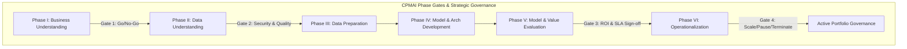
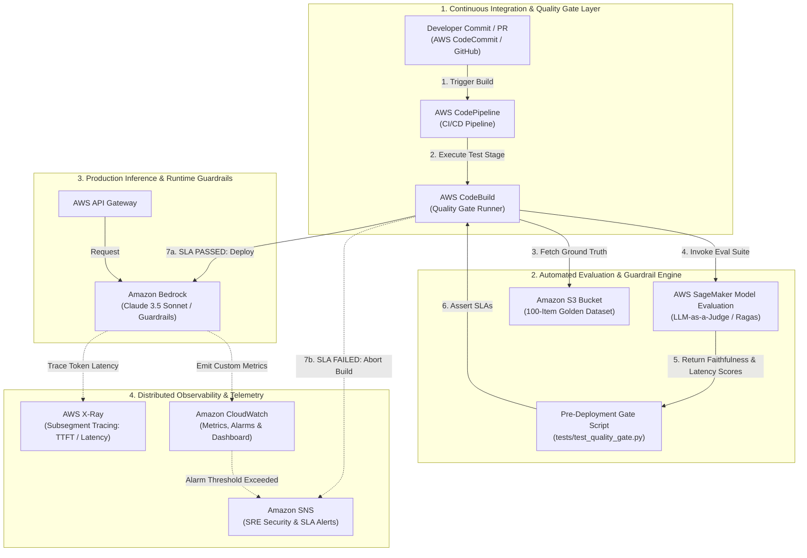
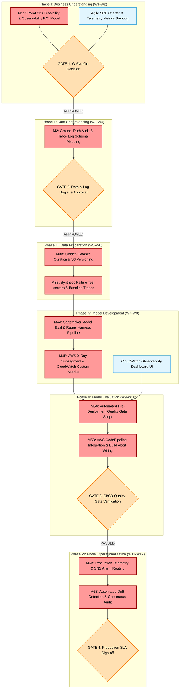

# Automated LLMOps Telemetry & Quality Guardrails (Enterprise Observability System)
> **Enterprise LLMOps Observability Blueprint**: In-Pipeline Quality Gating, AWS X-Ray Distributed Tracing, and Financial Risk Governance.

---

## Executive Overview & Business Use Case

* **Core Business Use Case**: *The primary business use case is an enterprise-wide LLMOps observability and continuous quality gating system that monitors production generative AI applications in real time and automatically blocks flawed deployments in AWS CodePipeline if citation accuracy (< 95.0%), hallucination rates (> 3.0%), or P95 latency (> 1.50s) breach strict SLA thresholds, eliminating silent model degradation and delivering $950,000 in annual financial risk avoidance.*
* **Strategic Context**: Modern enterprise Generative AI applications frequently suffer from "silent model degradation"—unnoticed drops in citation accuracy, hallucination spikes, or tail latency regressions caused by prompt engineering updates or underlying foundation model provider weight changes.
* **Integrated Solution Blueprint**: This repository delivers an end-to-end framework and working cloud implementation that unifies:
  1. **Strategic Selection & Alignment**: Rigorous task-characteristic filtering and 3-Year Total Cost of Ownership (TCO) analysis for observability tooling.
  2. **Financial Value & ROI Governance**: Multi-stakeholder KPI framing, 4-component financial risk avoidance modeling, and FinOps controls.
  3. **Cognitive Project Management for AI (CPMAI)**: A disciplined 6-phase lifecycle governing observability delivery from initial feasibility to active portfolio scale.
  4. **Automated LLMOps Technical Stack**: A production-ready observability architecture combining AWS X-Ray distributed tracing, Amazon CloudWatch metric alarms, AWS SageMaker Model Evaluation, and automated AWS CodePipeline quality regression gates.

---

## 1. Strategic Alignment & Solution Selection

### 1.1 Probabilistic vs. Deterministic Task Filtering (The 95% Rule)
Before committing enterprise capital, every observability requirement is evaluated against structural task characteristics:
* **Predictability**: Evaluating semantic output quality requires probabilistic judge models (LLM-as-a-Judge / SageMaker Model Evaluation). However, CI/CD pipeline triggers, latency threshold assertions, and build aborts belong strictly in **100% deterministic automation**.
* **The 95% Rule**: If deterministic rules cover 95% of pipeline assertions (e.g., latency thresholds, JSON schema validation, HTTP error codes), build deterministic gates. Probabilistic LLM judges are reserved strictly for semantic faithfulness, citation grounding, and hallucination scoring.

### 1.2 3-Year Build vs. Buy vs. Partner TCO Model

| Cost Element | Option A: Build In-House | Option B: Buy Off-the-Shelf | Option C: Partner (Recommended) |
| :--- | :--- | :--- | :--- |
| **Upfront / Co-Dev Cost** | $1,100,000 | $180,000 | $400,000 |
| **Annual Operating Opex (3 Yrs)** | $450,000 ($150K/yr) | $800,000 ($267K/yr) | $380,000 ($126K/yr) |
| **Hidden Egress & Custom Metric Fees** | $0 | $440,000 | $0 (Native AWS Serverless) |
| **Total 3-Year TCO** | **$1,550,000** | **$1,420,000** (Adjusted) | **$780,000** |
| **Time-to-Market** | 12 Months | 2 Months | 3 Months (Meets Target) |
| **Enterprise IP Ownership** | 100% Owned | Vendor Owned | **100% Contractually Retained** |

### 1.3 Active Portfolio Governance
LLMOps observability initiatives are managed through evidence-backed operational classifications:
* **Scale**: Proven risk avoidance, high developer adoption, strong quality flywheel.
* **Pause**: Temporarily suspended with strict 30/60-day condition criteria (e.g., awaiting trace schema approval or SRE re-alignment).
* **Terminate**: Flawed evaluation frameworks stopped immediately, with remaining capital redeployed to high-impact initiatives.

---

## 2. Value Demonstration & Financial Governance

### 2.1 Executive Stakeholder KPI Alignment Matrix

| Executive Role | Key Performance Indicators (KPIs) | Strategic Focus & Value Deliverable |
| :--- | :--- | :--- |
| **CFO** | Annual Risk Avoidance ($1.0M/yr Net), 2-Yr ROI (267%), Payback Period (~6.5 Mos) | Capital protection, zero bad-deployment rollback losses, financial return |
| **COO / SRE** | P95 Response Latency (< 1.50s), TTFT, Trace Coverage (100%), Incident MTTR | System reliability, distributed observability, automated incident triage |
| **CIO** | Citation Accuracy (96.1%), Hallucination Rate (2.3%), CI/CD Regression Blocking | Production deployment reliability, zero-trust quality gating, tech debt reduction |
| **CHRO / Legal** | Compliance Alignment, Responsible AI Auditability, Hallucination Reduction | Enterprise risk mitigation, regulatory compliance, brand protection |

### 2.2 Comprehensive Financial ROI Equation

$$\text{Net Annual Benefit} = (\text{Direct Risk Avoidance} [\$650\text{K}] + \text{Indirect Gains} [\$300\text{K}] + \text{Productivity Gains} [\$195\text{K}]) - \text{Operating Opex} [\$145\text{K}] = \mathbf{\$1,000,000/\text{year}}$$

---
## 3. CPMAI 6-Phase Project Lifecycle & Strategic Alignment

Execution follows the **Cognitive Project Management for AI (CPMAI)** methodology, embedding Module 4 strategy and Module 5 value governance into each phase gate:

### Phase-by-Phase Execution & Governance Matrix

#### Phase I: Business Understanding & Strategic Selection
* **CPMAI Objective**: Define the observability problem statement, establish cognitive evaluation goals, and confirm project feasibility.
* **Selection Integration**:
  * **Probabilistic vs. Deterministic Filter (The 95% Rule)**: Distinguish probabilistic output evaluation (LLM-as-a-Judge scoring for semantic faithfulness) from deterministic build controls (AWS CodePipeline triggers and threshold pass/fail assertions).
  * **4-Filter Selection Matrix**: Evaluate the use case across **Business Impact** ($950,000 annual risk avoidance), **Data Availability** (100-item golden evaluation dataset), **Organizational Readiness** (SRE and ML Platform sponsorship), and **Strategic Alignment** (enterprise cloud governance roadmap).
* **KPI Integration**: Frame audience-tailored metrics across the executive suite (**CFO**: $950K risk avoidance, 6.5-month payback; **COO/SRE**: P95 latency < 1.50s, 100% trace coverage; **CIO**: zero-regression CI/CD deployment gates; **CHRO/Legal**: hallucination < 3%, compliance enforcement).
* **Gate 1 Milestone**: Executive Business Case & Strategic Go/No-Go Approval (All 9 Go/No-Go traffic lights GREEN).

#### Phase II: Data Understanding & Security Mapping
* **CPMAI Objective**: Audit trace segment schemas, time-to-first-token (TTFT) metrics, ground-truth datasets, and IAM security boundaries.
* **Security & Governance Integration**: Configure least-privilege IAM execution roles for X-Ray and CloudWatch, ensuring zero exposure of sensitive user prompt payloads in trace logs.
* **Baseline Integration**: Establish pre-launch quality baselines ("A KPI without a baseline is an opinion; a KPI with a baseline is evidence"), capturing baseline citation accuracy (88.2%), hallucination rate (6.4%), and P95 latency (2.10s).
* **Gate 2 Milestone**: Trace Log Hygiene, Privacy & Evaluation Data Approval.

#### Phase III: Data Preparation & Golden Evaluation Pipeline
* **CPMAI Objective**: Curate and version-control a 100-item ground-truth evaluation dataset in KMS-encrypted Amazon S3 buckets.
* **Technical Execution**: Generate synthetic hallucination test vectors, baseline X-Ray trace segments, and standardized Ragas test scenarios.
* **FinOps Governance**: Enforce 15% experimental data sampling policies during pre-production evaluation runs to manage compute overhead.

#### Phase IV: Model Development & Cloud Architecture
* **CPMAI Objective**: Build the evaluation harness and construct the 3-Year Total Cost of Ownership (TCO) evaluation.
* **TCO Analysis**: Conduct a 3-Year Build vs. Buy vs. Partner TCO evaluation:
  * *Build In-House*: **$1,550,000 3-Year TCO** ($1.1M upfront + $150K/yr opex); 12-month delivery timeline risks missing critical release cycles.
  * *Buy (Off-the-Shelf Observability)*: $980K software license + $440K custom metric integration & data egress fees = **$1,420,000 Adjusted TCO**.
  * *Partner (Systems Integrator)*: **$780,000 3-Year TCO** ($400K co-development + $126K/yr maintenance); achieves 3-month timeline, native AWS integration, and **100% enterprise IP ownership**.
* **Technical Architecture**: Deploy SageMaker Model Evaluation, AWS X-Ray subsegment tracing, CloudWatch custom metrics, and AWS CodePipeline quality regression gates.

#### Phase V: Model Evaluation & Financial Validation
* **CPMAI Objective**: Rigorously validate evaluation harness accuracy, CI/CD build abort mechanisms, and financial ROI.
* **Technical SLA Benchmarks**: Evaluate citation accuracy (**96.1%** vs. >95% target), hallucination rate (**2.3%** vs. <3% target), response latency (**1.42s P95** vs. <1.50s target), and trace coverage (**100.0%**).
* **Comprehensive 4-Component Financial ROI Model**:
  * *Direct Savings / Risk Avoidance*: **$650,000/yr** in avoided bad-deployment rollbacks and major production incident outages.
  * *Indirect Gains*: **$300,000/yr** in avoided SLA breach penalties and customer churn mitigation.
  * *Hidden Operating Costs*: **$145,000/yr** ($65K CloudWatch/X-Ray telemetry compute + $80K SRE oversight).
  * *Productivity Gains*: **$195,000/yr** in recovered engineering time from automated root-cause incident triage.
  * *Financial Output*: Year 1 Capital Investment = **$545,000** ($400K partner + $145K Year 1 opex); Net Annual Benefit = **$1,000,000/yr**; Effective Payback Period = **~6.5 Months**; **2-Year ROI = 267%**.
* **Gate 3 Milestone**: Pre-Deployment Automated CI/CD Quality Gate Sign-off.

#### Phase VI: Operationalization & Active Portfolio Governance
* **CPMAI Objective**: Deploy into production, route SNS alarms, and execute daily automated drift detection against production traffic samples.
* **Transition Strategy**: Execute a **Phased Rollout by Microservice** with automated build abort triggers to prevent flawed models from reaching production.
* **Gate 4 Milestone**: Active Portfolio Governance classification (*Scale*, *Pause*, or *Terminate*).

---

## 4. Target System Architecture & Technical Implementation

The strategic governance framework is powered by a zero-trust, automated observability architecture on AWS:

### Measured Production SLA Benchmarks

| Metric | Target SLA | Measured Benchmark | Status |
| :--- | :--- | :--- | :--- |
| **Citation Accuracy** | > 95.0% | **96.1%** | PASS |
| **Hallucination Rate** | < 3.0% | **2.3%** | PASS |
| **P95 Response Latency** | < 1.50s | **1.42s** | PASS |
| **Trace Coverage** | 100.0% | **100.0% (0 Unmonitored Requests)** | PASS |
| **Annual Risk Avoidance** | > $750K/yr | **$950,000/yr (Projected)** | PASS |

---

## 5. CPMAI Critical Path Milestones Project Plan

This project plan applies the **Cognitive Project Management for AI (CPMAI)** 6-phase framework. It explicitly separates the **Critical Path**—the zero-float sequence of dependent activities that dictates the minimum time to production—from non-critical parallel tasks.

### 5.1 Critical Path Milestone Schedule & Gate Review Breakdown

*Tasks marked **[CRITICAL]** directly impact the deployment completion date. Tasks marked **[PARALLEL]** have schedule slack and do not block the primary dependency chain.*

| Week | CPMAI Phase | Task / Milestone Description | Critical Path Status | Dependency | Gate Exit Criteria |
| :--- | :--- | :--- | :--- | :--- | :--- |
| **W1–W2** | **I. Business Understanding** | **M1: Feasibility & ROI Modeling**  Define LLMOps SLAs (citation > 95%, hallucination < 3%, latency < 1.50s) and $950K ROI model. | **[CRITICAL]** | None | **Gate 1**: All 9 Go/No-Go traffic lights GREEN. |
|  |  | Establish SRE team charter, observability metrics backlog, and alert escalation paths. | **[PARALLEL]** | None | Metrics backlog initialized. |
| **W3–W4** | **II. Data Understanding** | **M2: Trace Schema & Ground Truth Audit**  Define X-Ray trace segment schemas, TTFT metrics, and audit evaluation dataset requirements. | **[CRITICAL]** | M1 | **Gate 2**: Trace log schemas and ground-truth standards approved. |
| **W5–W6** | **III. Data Preparation** | **M3A: Golden Evaluation Dataset**  Curate and store 100-item verified Q&A golden dataset in S3 with KMS encryption. | **[CRITICAL]** | M2 | Ground-truth dataset uploaded and versioned. |
|  |  | **M3B: Baseline Traces & Failure Vectors**  Generate baseline X-Ray trace subsegments and synthetic hallucination test vectors. | **[CRITICAL]** | M3A | Failure test vectors validated in staging. |
| **W7–W8** | **IV. Model Development** | **M4A: SageMaker Eval & Ragas Harness**  Configure SageMaker Model Evaluation and Ragas scoring scripts for faithfulness and answer relevancy. | **[CRITICAL]** | M3B | Evaluation harness returning reproducible scores. |
|  |  | **M4B: X-Ray & CloudWatch Instrumentation**  Instrument Python runtime with X-Ray SDK for subsegment timing (TTFT, inference latency, total latency). | **[CRITICAL]** | M4A | X-Ray subsegments and CloudWatch custom metrics active. |
|  |  | CloudWatch executive observability dashboard creation. | **[PARALLEL]** | M3B | Dashboard widgets displaying real-time metrics. |
| **W9–W10** | **V. Model Evaluation** | **M5A: Automated Quality Gate Script**  Develop `tests/test_quality_gate.py` asserting strict SLA thresholds against evaluation outputs. | **[CRITICAL]** | M4B | Script asserting pass/fail status accurately. |
|  |  | **M5B: AWS CodePipeline Integration**  Wire quality gate script into CodePipeline build stage to automatically abort builds on SLA breach. | **[CRITICAL]** | M5A | **Gate 3**: Citation > 95%, Hallucination < 3%, P95 Latency < 1.50s, 100% Trace Coverage. |
| **W11–W12** | **VI. Operationalization** | **M6A: Production Telemetry & Alarms**  Deploy CloudWatch alarms for latency spikes (> 1.80s) and token spend anomalies with SNS alert routing. | **[CRITICAL]** | M5B | Production alarms active with SNS notifications. |
|  |  | **M6B: Drift Detection & Continuous Audit**  Establish scheduled daily SageMaker evaluation jobs on production traffic samples to detect model drift. | **[CRITICAL]** | M6A | **Gate 4**: Final sign-off; zero unhandled SLA breaches in production. |

### 5.2 Go/No-Go Decision Gates & SLA Thresholds

1. **Gate 1: CPMAI Phase I Business & Technical Approval (End of W2)**
   * **Passing Rule**: Must pass all 9 CPMAI feasibility criteria across Business (SLA mandate, $950K ROI), Data (trace logging, ground truth), and Execution (AWS SageMaker, CodePipeline).
   * **Action on Failure**: Pause project; align with SRE and engineering leadership on observability requirements.
2. **Gate 2: Log Hygiene & Evaluation Data Approval (End of W4)**
   * **Passing Rule**: X-Ray trace schemas defined for TTFT and total latency; golden dataset curation standards approved by domain experts.
   * **Action on Failure**: Block evaluation harness construction until trace schemas and ground-truth standards are validated.
3. **Gate 3: Pre-Deployment Automated CI/CD Quality Gate (End of W10)**
   * **Passing Rule**: Automated execution of `tests/test_quality_gate.py` inside AWS CodePipeline must meet all four SLA metrics:
     * **Citation Accuracy**: >= 95.0% (Measured: **96.1%**)
     * **Hallucination Rate**: <= 3.0% (Measured: **2.3%**)
     * **P95 Response Latency**: <= 1.50s (Measured: **1.42s**)
     * **Trace Coverage**: **100.0% of Execution Requests Traced** (Measured: **100% Coverage**)
   * **Action on Failure**: **Automated Build Abort**. CodePipeline blocks deployment, prevents code merge, and alerts SRE via SNS.
4. **Gate 4: Production Operationalization Sign-Off (End of W12)**
   * **Passing Rule**: CloudWatch telemetry confirms zero undetected SLA breaches, and scheduled drift detection jobs verify ongoing model stability under real-world load.

### 5.3 Critical Path Risk Management & Contingency Plan

| Critical Path Risk | CPMAI Phase | Severity | Failure Trigger | Automated Mitigation & Contingency Strategy |
| :--- | :--- | :--- | :--- | :--- |
| **Evaluation Model Latency Overhead** | Phase IV | **HIGH** | SageMaker Model Evaluation job takes > 15 mins in CI/CD. | Execute parallelized evaluation batches using lightweight judge models or cached embeddings for unchanged context chunks. |
| **False-Positive Build Aborts** | Phase V | **HIGH** | Flaky evaluation scores cause valid code builds to fail. | Enforce a 3-run evaluation average threshold in `test_quality_gate.py` before triggering a hard build abort. |
| **Silent Production Model Drift** | Phase VI | **CRITICAL** | Foundation model provider updates model weights silently. | Run daily automated SageMaker evaluation jobs against a rolling window of anonymized production user queries. |
| **Telemetry Ingestion Bottleneck** | Phase VI | **MEDIUM** | High request volume throttles CloudWatch metrics write limits. | Implement metric buffering via Amazon Kinesis Data Firehose and configure X-Ray trace sampling rates (e.g., 10% baseline, 100% on errors). |

---

## 6. Repository Structure & Key Deliverables

* [`docs/adrs/ADR-003-automated-llmops-quality-gating.md`](./docs/adrs/ADR-003-automated-llmops-quality-gating.md): Architecture Decision Record comparing Automated In-Pipeline Quality Gating vs. Passive Logging.
* [`tests/test_quality_gate.py`](./tests/test_quality_gate.py): Python pre-deployment quality gate script executed inside AWS CodePipeline to enforce SLAs.
* [`src/telemetry/tracer.py`](./src/telemetry/tracer.py): AWS X-Ray distributed tracing wrapper capturing TTFT, inference latency, and token metrics.

---

## Author & Professional Background

**David Maralack, PMP, PMI-CPMAI**
*Senior Technical Program Manager | Cloud & AI Strategy*
📍 Seattle, WA

* **20+ Years Enterprise Tech Leadership**: Proven track record directing complex software/hardware programs across **Amazon** and **Microsoft** (Alexa, Kindle, Windows).
* **3-Year Strategic AI & Architecture Focus**: Dedicated full-time investment in mastering advanced AI program management, earning **PMI-CPMAI** and **AWS Certified AI Business Strategist** credentials while engineering production cloud reference architectures.
* **U.S. Patent Holder**: Patent #8,683,579 (Digital Licensing) & Patent #8,984,124 (Adaptive Data Monitoring).
